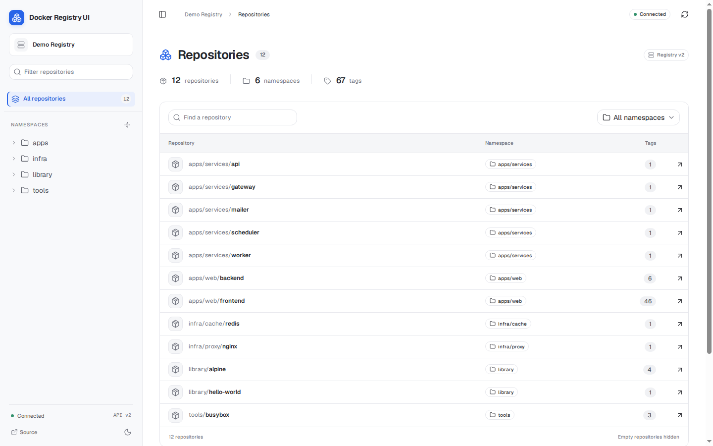
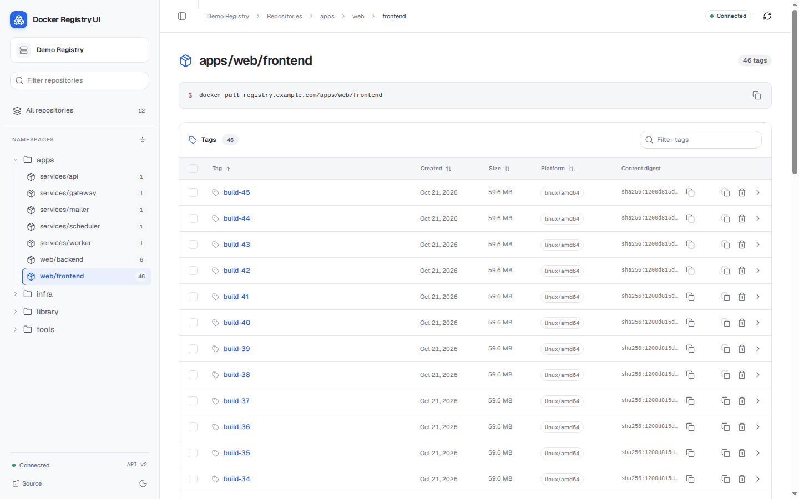
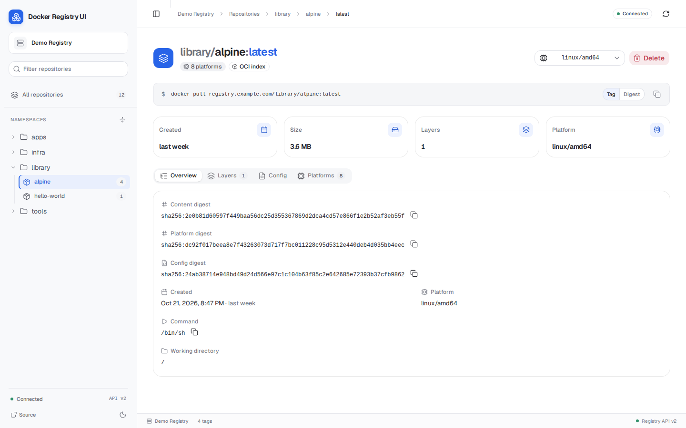
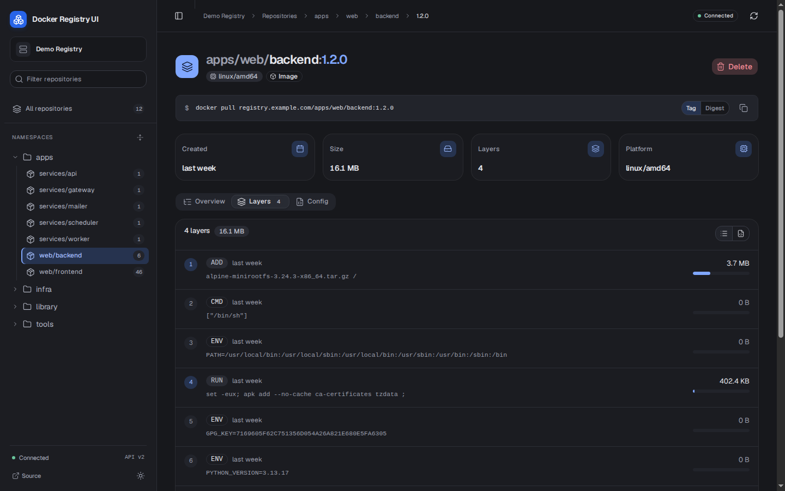

# Docker Registry User Interface

[](https://github.com/Joxit/docker-registry-ui/stargazers)
[](https://hub.docker.com/r/joxit/docker-registry-ui)
[](https://github.com/sponsors/Joxit)
[](https://artifacthub.io/packages/search?repo=joxit)
[](https://github.com/Joxit/docker-registry-ui/releases)

> [!NOTE]
> This fork replaces the original Riot.js interface with a new design built on React and [shadcn/ui](https://ui.shadcn.com). The container, the nginx proxy, and all the settings work the same way.

## Overview

This project aims to provide a simple and complete user interface for your private docker registry. You can customize the interface with various options. The major option is `SINGLE_REGISTRY` which allows you to disable the dynamic selection of docker registries (same behavior as the old **static** tag).

You may need the [migration guide from 1.x to 2.x](https://github.com/Joxit/docker-registry-ui/wiki/Migrating-from-1.x-to-2.x) or [the 1.x readme](https://github.com/Joxit/docker-registry-ui/blob/8fe3adf12540d1316cb57628ebe86a392a703d90/README.md). The project support both [docker registry v2](https://github.com/distribution/distribution/releases/tag/v2.0.0) and [docker registry v3](https://github.com/distribution/distribution/releases/tag/v3.0.0).

The interface uses [React](https://react.dev), TypeScript, [Vite](https://vite.dev), [Tailwind CSS](https://tailwindcss.com), and [shadcn/ui](https://ui.shadcn.com) components. It builds to static files, and nginx serves them in the Docker image.

- A sidebar explorer lists your repositories by namespace.
- The repository page lists the tags in a table that you can sort, filter, and page through.
- Each tag has its own page. It shows the content digest, the size, the layers, the configuration, and every platform of a multi-arch image.

If you like my work and want to support it, don't hesitate to [sponsor me](https://github.com/sponsors/Joxit).

## Docker image

This fork does not publish a Docker image yet. Build it from source:

```bash
git clone https://github.com/nick-hio/docker-registry-ui.git
cd docker-registry-ui
docker build -t docker-registry-ui:local .
```

Then run it like the upstream image, with the same environment variables:

```bash
docker run -d -p 127.0.0.1:8080:80 \
  -e NGINX_PROXY_PASS_URL=http://registry:5000 \
  -e SINGLE_REGISTRY=true \
  docker-registry-ui:local
```

The upstream images (`joxit/docker-registry-ui`) contain the original interface. For the image variants and a full Docker Compose setup, see [Deployment](docs/deployment.md). For all the settings, see [Configuration](docs/configuration.md).

## Screenshots



| Tags | Tag page | Layers (dark theme) |
| --- | --- | --- |
|  |  |  |

Upstream project: [project page](https://joxit.dev/docker-registry-ui), [live demo](https://joxit.dev/docker-registry-ui/demo/) (original interface), [Helm chart](https://helm.joxit.dev/).

## Hidden Features

- Delete many tags at once. Select tags with the checkboxes, or select the whole page with the checkbox in the table header (see [#29](https://github.com/Joxit/docker-registry-ui/issues/29) and [#79](https://github.com/Joxit/docker-registry-ui/pull/79)).
- Sort the tag list by tag, creation date, size, or platform. The tag order sorts numbers correctly (see [#45](https://github.com/Joxit/docker-registry-ui/pull/45) and [#46](https://github.com/Joxit/docker-registry-ui/pull/46)) and follows `TAGLIST_ORDER`.
- Share a link to a tag page. The link keeps the open tab and the selected platform, for example `#/repositories/library%2Falpine/tags/latest?tab=layers&platform=linux/arm64v8`. Links from the original interface (`#!/taglist/...` and `#!/taghistory/...`) still open the right page.
- Share your docker registry UI when you deploy it with `SINGLE_REGISTRY=false`.
  - Open the UI with the query parameter `url` (e.g. `https://registry-ui.example.com/?url=https://registry.example.com`). If you need credentials on your private registry, you must set `Access-Control-Allow-Origin` to the origin of the UI.
  - Use a single interface with many registries. Add them with the registry menu at the top of the sidebar.
- Filter repositories and tags with the filter fields. `CTRL + F` or `F3` selects the repository filter on the catalog page and the tag filter on a repository page. When the filter already has the focus, the shortcut does what the browser does by default (see [#213](https://github.com/Joxit/docker-registry-ui/issues/213)).
- See every platform of a multi-arch image on the tag page. Select a platform with the platform menu or the **Platforms** tab (see [#130](https://github.com/Joxit/docker-registry-ui/issues/130)).
- Copy the `docker pull` command by tag or by digest.
- Show the Dockerfile that the image history describes, and copy it (**Layers** tab, see [#286](https://github.com/Joxit/docker-registry-ui/pull/286)).
- The UI caches requests that cannot change, such as blobs and manifests by digest (URL with `sha256:`).
- Switch between the light and the dark theme with the button at the bottom of the sidebar.

See all the settings in [Configuration](docs/configuration.md).

## Documentation

| Page | Contents |
| --- | --- |
| [Configuration](docs/configuration.md) | All the environment variables of the container |
| [Deployment](docs/deployment.md) | Image variants, Docker Compose, an unprivileged user, and HTTPS |
| [Registry configuration](docs/registry.md) | CORS, image deletion, and a full registry configuration file |
| [Examples](docs/examples.md) | Ready-to-run setups in the `examples` directory |
| [FAQ](docs/faq.md) | Common questions and errors |

## Development

See the [Development section of CONTRIBUTING.md](CONTRIBUTING.md#development) to run the interface on your computer, run the tests, and build the Docker image.
